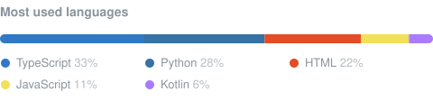

# Hey, I'm Ruchin 👋

  
  
  
  

### About me

- 🎓 Computer Science (AWS specialization) at **JECRC University**, Jaipur
- ☁️ I like the whole stack: **cloud, backend, and the UI people actually touch**
- 🤖 Lately: **Telegram bots, Mini Apps and real-time systems**
- 🎮 Off the keyboard: gaming and music production

### ⭐ Featured: MediFast

<table>
<tr>
<td width="58%">

**Ask every chemist nearby. At once.**

Send your medicine list on Telegram. Every participating pharmacy nearby taps what they have, and you watch the answers arrive live. Reserve, then pick up.

- Telegram bot + Mini App for customers *and* pharmacists
- Live, self-updating answers and a map
- Exact medicine matching: `Pan 20` never becomes `Pan 40`
- TypeScript · Node · SQLite · React, tested end to end

<a href="https://github.com/Ruchin-Audichya/MediFastRX-Bot"><b>View the project →</b></a>

</td>
<td width="42%">

</td>
</tr>
</table>

### 🛠️ Recently active

<!--START:projects-->
| Project | What it is | Built with | Updated |
| --- | --- | --- | --- |
| [**portfolio**](https://github.com/Ruchin-Audichya/portfolio) | Source for ruchinaudichya.in: Next.js 14 portfolio with live, in-browser demos of Anvil… | TypeScript | 2 days ago |
| [**anvil-usb**](https://github.com/Ruchin-Audichya/anvil-usb) ⭐ 1 | Forge bootable Windows & Linux USB drives with just your Android phone — no PC, no root… | Kotlin | 1 week ago |
| [**StudentPilot**](https://github.com/Ruchin-Audichya/StudentPilot) | Find My Stipend: one internship search across Internshala, LinkedIn and company career… | TypeScript | 3 weeks ago |
| [**Yatra-Sync**](https://github.com/Ruchin-Audichya/Yatra-Sync) ⭐ 1 | Shared-cab matching for commuters: groups riders going the same way and splits the fare… | TypeScript | 3 weeks ago |
| [**MediAtlas**](https://github.com/Ruchin-Audichya/MediAtlas) | MediAtlas — The intelligence backbone powering MediFast with pharmacy networks, invento… | Python | 5 months ago |
<!--END:projects-->

### 🧰 Toolbox

  

### 📈 On GitHub

<!--START:stats-->
  
<!--END:stats-->

  

<picture>
  <source media="(prefers-color-scheme: dark)" srcset="https://raw.githubusercontent.com/Ruchin-Audichya/Ruchin-Audichya/output/snake-dark.svg" />
  
</picture>

### ⚡ Latest activity

<!--START:activity-->
- 🚀 Pushed to [portfolio](https://github.com/Ruchin-Audichya/portfolio) 2 days ago
- 🚀 Pushed to [portfolio](https://github.com/Ruchin-Audichya/portfolio) · `linkedin-assets` 2 days ago
- 🚀 Pushed to [MediFastRX-Bot](https://github.com/Ruchin-Audichya/MediFastRX-Bot) · `claude/magical-rubin-rwoouv` 1 week ago
- 🚀 Pushed to [anvil-usb](https://github.com/Ruchin-Audichya/anvil-usb) 1 week ago
- 🚀 Pushed to [MediFastRX-Bot](https://github.com/Ruchin-Audichya/MediFastRX-Bot) 1 week ago
- 📦 Released v0.3.1 of [anvil-usb](https://github.com/Ruchin-Audichya/anvil-usb) 1 week ago
<!--END:activity-->

This page refreshes itself every day.

